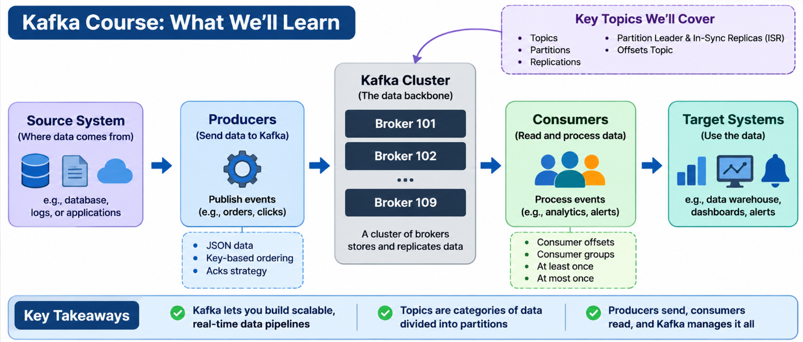

# 1.3 Course objectives

**Course Objectives Summary**  
Complete Guide to Apache Kafka for Beginners

Here is the redesigned Kafka course infographic with explanations of each component.

**How to read the diagram:**
1. Source Systems: Databases, application logs, and other systems generate data.
2. Producers: Applications that publish events (messages) into Kafka.
3. Kafka Cluster: A group of brokers that stores and replicates messages.
4. Consumers: Applications that retrieve and process messages.
5. Target Systems: Data warehouses, dashboards, analytics platforms, and alerting systems.

**Important concepts covered:**
- Topics and partitions
- Replication and fault tolerance
- Partition leaders and in-sync replicas (ISR)
- Producer acknowledgments (ACKs)
- Consumer groups and offsets
- At-least-once and at-most-once delivery
Big picture: Kafka acts as a distributed messaging platform connecting systems so they can exchange data reliably and in real time.

### What You’ll Learn
- **Kafka fundamentals**: Clusters, brokers, producers (ingesting data from source systems), consumers (delivering data to target systems)
- **Cluster management**: Traditional Zookeeper vs. modern KRaft mode
- **Hands-on tooling**: Conduktor UI for starting and interacting with Kafka
- **Extended ecosystem**: Introductions to Kafka Connect, Kafka Streams, and Confluent Schema Registry
- **Enterprise context**: Real-world architectures, use cases, advanced APIs, and topic configurations

### Course Structure
1. **Part 1 – Fundamentals** (~4 hours)  
   - End-to-end Kafka theory  
   - Local setup (Linux, Windows, Mac)  
   - Kafka CLI interaction  
   - First Java producers and consumers  

2. **Real-world Architecture**  
   - More advanced Java examples (Wikimedia producer + open-source consumer)  
   - Kafka Connect, Kafka Streams, Schema Registry  
   - Case studies and enterprise usage  

3. **Part 3 – Advanced Topics**  
   - Advanced topic configurations and additional advanced lectures  

### Prerequisites
- Comfortable with the command line (preferred)  
- Some programming experience (Java 11 is used; code is provided so pure beginners can still follow)  
- Linux or Mac strongly preferred (Windows instructions and caveats are included)  
- Willingness to learn  

### Who This Course Is For
- Developers who want to write Kafka-powered applications  
- Architects who need to understand Kafka’s role in enterprise pipelines  
- DevOps/engineers interested in topics, partitions, and multi-broker setups  

### Position in the Larger Series
This is **Volume 1 – Kafka for Beginners**. It gives a solid foundation. Later courses cover Kafka Connect, Streams, ksqlDB, Confluent components, Security, Monitoring, and Cluster Administration. Recommended path: finish Beginners first, then specialize (developer track vs. admin track). Also useful preparation for Confluent Developer and Operator certifications.

###  Apache Kafka Series
* **Kafka For Beginners:** get a strong base for Kafka, basic operations, write your first producers and consumers
* **Kafka Connect API:** Understand how to import / export data to / from Kafka
* **Kafka Streams API:** Learn how to process and transform data within Kafka
* **ksqlDB:** Write Kafka Streams applications using SQL
* **Confluent Components:** REST Proxy and Schema Registry
* **Kafka Security:** Setup Kafka security in a Cluster and Integrate your applications with Kafka Security
* **Kafka Monitoring and Operations:** use Prometheus and Grafana to monitor Kafka, learn operations
* **Kafka Cluster Setup & Administration:** Get a deep understanding of how Kafka & Zookeeper works, how to Setup Kafka and various administration tasks
* **Confluent Certifications for Developers Practice Exams**
* **Confluent Certifications for Operators Practice Exams**

---

## [Context](./../../context.md)