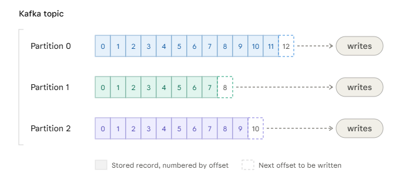

# 2.1 Topics partitions and offsets

## What Is a Kafka Topic?

A **topic** is a particular stream of data inside a Kafka cluster.

- A cluster can contain many topics (e.g. `logs`, `purchases`, `twitter_tweets`, `trucks_gps`).
- Topics are identified **by name**.
- Analogy: a topic is similar to a **table** in a database, but without schema constraints or querying capabilities.
- You can send **any message format**: JSON, Avro, text, binary, etc.
- The sequence of messages in a topic is called a **data stream** — this is why Kafka is a data-streaming platform.
- You **cannot query** a topic.  
  - Write data → **Producers**  
  - Read data → **Consumers**

---

## Partitions

Topics are divided into **partitions**.

- A topic can have any number of partitions (3, 10, 100…).
- Example: a topic with 3 partitions → Partition 0, Partition 1, Partition 2.
- Messages written to a topic land in one of its partitions.
- **Order is guaranteed only within a single partition**, not across partitions.

---

## Offsets

Each message inside a partition receives a sequential ID called an **offset**.

- Offsets start at 0 and increase by 1 for every new message in that partition.
- Offset 3 in Partition 0 is **not** the same message as offset 3 in Partition 1.
- Offsets are **never reused**, even after old messages are deleted.
- Offsets only have meaning **inside their own partition**.

---

## Key Properties of Topics & Partitions

| Property                    | Description                                                                 |
|----------------------------|-----------------------------------------------------------------------------|
| **Immutability**           | Once data is written to a partition it **cannot** be changed or deleted by the application. |
| **Retention**              | Data is kept for a limited time (default = **1 week**, configurable). After that it is removed. |
| **Ordering**               | Guaranteed **only within a partition**. No global order across partitions.  |
| **Partition assignment**   | By default messages go to a **random** partition. Providing a **key** changes this behaviour (covered later). |
| **Number of partitions**   | Chosen at topic creation time. Can be 3, 10, 100… (how to choose is covered later). |

---

## Concrete Example: Trucks GPS

1. Fleet of trucks each send GPS position every 20 seconds.
2. Message content example: `{ truck_id, latitude, longitude }`.
3. All trucks produce into a topic named `trucks_gps`.
4. Topic is created with **10 partitions**.
5. Multiple independent consumers can read the same stream:
   - Location dashboard (real-time map)
   - Notification service (alert customers when delivery is near)

This demonstrates Kafka’s strength: **one write, many independent readers**.

---

## Important Takeaways

- Topics = named data streams.
- Partitions = the unit of parallelism and ordering.
- Offsets = the unique position of a message inside a partition.
- Data is immutable and time-limited.
- Order is per-partition only.
- Multiple consumers can independently read the same topic.

These three concepts (topics, partitions, offsets) form the foundation of how Kafka stores and delivers data.

* **Topic:** a named stream of records, such as orders or clicks. It is split into partitions so the data can be spread across servers.
* **Partition:** an ordered, append-only log. Records are only added at the end and are never inserted in the middle or rewritten.
* **Offset:** the number in each cell. It is the record's position within its own partition. Offsets start at 0 and always increase.
* **Dashed cell:** the next offset to be written. Partition 0 holds offsets 0–11 and will write 12 next. Partition 1 will write 8 next. Partition 2 will write 10 next.
* **Writes:** producers append to the end of a partition. Each partition grows at its own pace, which is why the three lengths differ.

### Why it works this way

* **Ordering:** Kafka guarantees order only within a partition. Offset 5 always comes before offset 6 in the same partition. There is no global order across partitions.
* **Keys:** records with the same key (for example, a user ID) go to the same partition, so one user's events stay in order.
* **Scaling:** more partitions let more producers write and more consumers read in parallel.
* **Consumers:** each consumer tracks its own offset per partition. That lets it replay old records or resume where it stopped.

## [Context](./../../context.md)