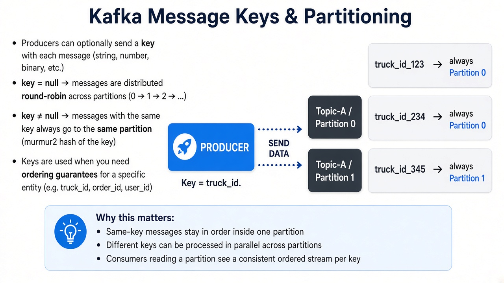
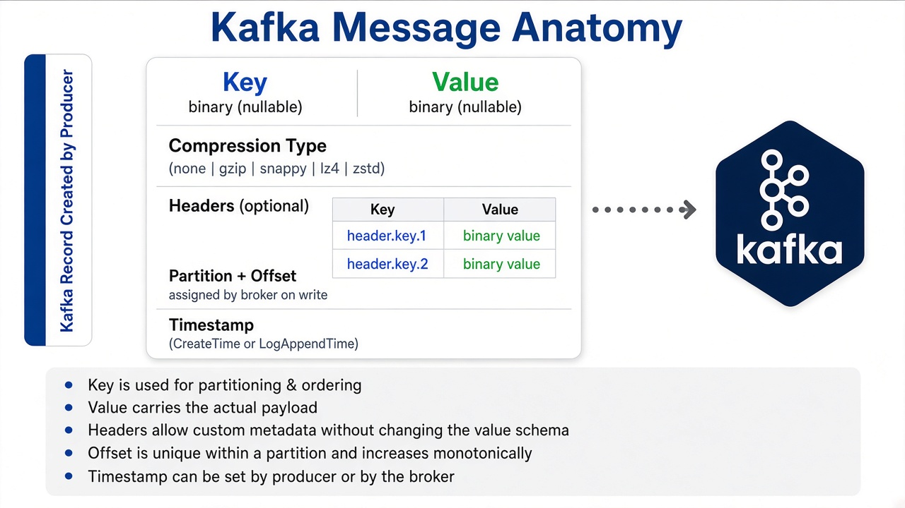
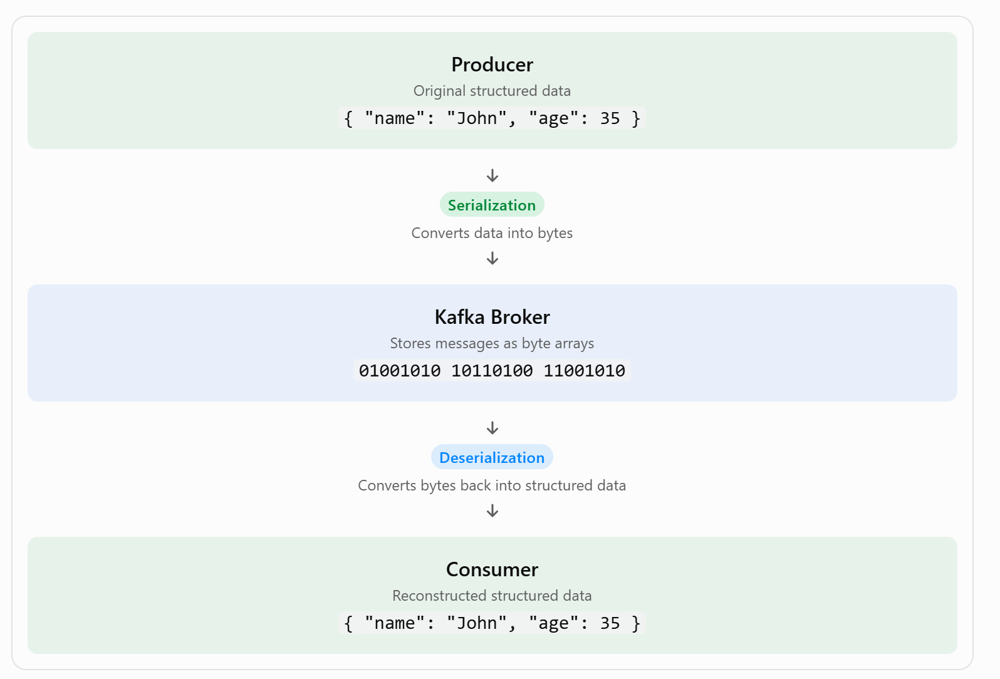
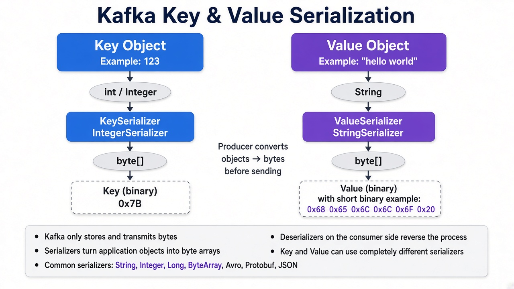

# 2.2 Producers and message keys

# What Are Producers?

**Producers** are the applications that **write data** into Kafka topics.

- They send messages to topic partitions.
- The producer (not the broker) decides **in advance** which partition a message will go to.
- Producers know which broker holds each partition and can automatically recover if a broker fails.
- Because messages are spread across many partitions, producers provide natural **load balancing** and enable Kafka to scale.

---

## Message Keys

Every Kafka message can optionally contain a **key**.

| Case              | Behaviour                                                                 |
|-------------------|---------------------------------------------------------------------------|
| **Key = null**    | Messages are distributed in **round-robin** fashion across partitions → good load balancing. |
| **Key ≠ null**    | All messages with the **same key** always go to the **same partition** (via hashing). |

### Why keys matter

Keys give you **ordering guarantees for a specific entity**.

**Example – Trucks GPS**  
- Use `truck_id` as the message key.  
- All position updates for truck `123` always land in the same partition → they stay in order.  
- Different trucks may go to different partitions, but each individual truck’s history remains ordered.



---

## Anatomy of a Kafka Message

A message created by a producer contains:

| Field        | Description                                      | Notes                          |
|--------------|--------------------------------------------------|--------------------------------|
| **Key**      | Optional identifier (binary)                     | Can be null                    |
| **Value**    | The actual payload (binary)                      | Usually present                |
| **Headers**  | Optional list of key-value pairs                 | Metadata                       |
| **Partition**| Target partition (chosen by producer)            | Determined at send time        |
| **Offset**   | Assigned by the broker after the message is written | —                            |
| **Timestamp**| Set by the system or by the user                 | —                              |
| **Compression** | Optional (gzip, snappy, lz4, zstd)            | Reduces size                   |


---

## Serialization

### Benefits of Data Serialization

Serialization is the process of converting data structures or objects into a format that can be stored or transmitted and later reconstructed (deserialization).

It is especially important in distributed systems, databases, Kafka, APIs, and microservices.

**Key Benefits**
1. Data Storage – Converts data into a format that can be saved to files, databases, or other storage systems.

2. Data Transmission – Makes it possible to send data between applications, servers, and distributed systems over a network.

3. Cross-Platform Compatibility – Allows applications written in different programming languages to exchange data using a common format.

4. Reduced Data Size – Some serialization formats use compact binary representations, reducing network bandwidth and storage requirements.

5. Performance – Efficient serialization formats can make data processing and communication faster.

6. Data Persistence – Allows data to be saved and reconstructed later, even after an application has stopped running.

7. Distributed Communication – Enables services and systems to exchange structured data reliably.

**Common Serialization Formats**
| Format	        | Type	    | Common Use                    | 
|-------------------|-----------|-------------------------------| 
| JSON	            | Text	    | REST APIs, web applications   | 
| XML	            | Text	    | Enterprise applications       | 
| Avro	            | Binary	| Apache Kafka, data pipelines  | 
| Protocol Buffers	| Binary	| Microservices, gRPC           | 
| MessagePack	    | Binary	| Efficient data exchange       | 

**Serialization in Apache Kafka**
Serialization is particularly important in Kafka because Kafka producers must convert messages into bytes before sending them to Kafka brokers.




Kafka only deals with **bytes**.

- Producers must **serialize** (convert) objects into bytes before sending.
- Separate serializers are used for the **key** and the **value**.
- Common serializers: String, Integer, Float, JSON, Avro, Protobuf, etc.

**Example**  
- Key = integer `123` → IntegerSerializer → bytes  
- Value = string `"hello world"` → StringSerializer → bytes  

Once both are bytes, the message is ready to be sent.



---

## How Partition Choice Works (Advanced)

1. The producer’s **Partitioner** looks at the message.
2. If a key is present, the key bytes are hashed (default algorithm: **murmur2**).
3. The hash result is mapped to a partition number.
4. The message is then sent to that specific partition.

→ **The producer chooses the partition**, not the broker.

Kafka Default Partitioner formula:
```java
targetPartition = Utils.toPositive(Utils.murmur2(keyBytes)) % numPartitions
```

### Notes:
* Utils.toPositive(...) is equivalent to hash & 0x7fffffff (clears the sign bit to make the value positive).
* Using Math.abs() is not the same and can produce different results (especially for Integer.MIN_VALUE).
* The modulo is against numPartitions, not numPartitions - 1.

---

## Key Takeaways

- Producers write data and decide the target partition.
- **Null key** → round-robin (load balancing).
- **Non-null key** → same key always goes to the same partition (ordering).
- Keys are the mechanism that gives you per-entity ordering.
- Everything is ultimately sent as bytes (serialization is required).
- Partition selection happens client-side via hashing.


## [Context](./../../context.md)