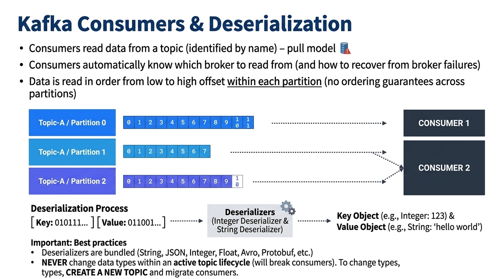

# 2.3 Consumers and deserialization

## 1. Overview of Kafka Consumers
* **Purpose:** Consumers are used to read data from Kafka topics.
* **Pull Model:** Kafka consumers implement a **pull model** (rather than a push model). Consumers actively request data from Kafka brokers (servers) and receive responses back, rather than brokers pushing data to them.
* **Partition Consumption:** 
  * A single consumer can read from one partition (e.g., Partition 0) or multiple partitions simultaneously (e.g., Partition 1 and Partition 2).
* **Fault Tolerance & Broker Discovery:** Consumers automatically know which Kafka broker to read from for a given partition. If a broker fails, consumers are smart enough to recover and reroute automatically.

---

## 2. Message Ordering Guarantees
* **In-Order Within Partitions:** Data is always read in order from low to high offsets (`0, 1, 2, 3...`) within each individual partition.
* **No Cross-Partition Ordering:** If a consumer reads from multiple partitions (e.g., Partition 1 and Partition 2), there are **no ordering guarantees across different partitions**. Ordering only applies strictly within a single partition.

---

## 3. Consumer Deserialization
Because Kafka stores and transmits messages (keys and values) in a binary format (bytes), consumers must transform these bytes back into usable objects in their respective programming languages.

* **How It Works:**
  * The consumer must know the expected data format of the key and value **in advance**.
  * **Example:** 
    * *Key:* Bytes $\rightarrow$ **Integer Deserializer** $\rightarrow$ Integer (`123`)
    * *Value:* Bytes $\rightarrow$ **String Deserializer** $\rightarrow$ String (`"hello world"`)
* **Built-in Deserializers:** Apache Kafka comes bundled with standard deserializers for common formats, including:
  * String (including JSON)
  * Integer & Float
  * Avro & Protobuf (and more)

---

## 4. Schema & Data Type Lifecycle Rules
* **Do Not Change Topic Data Types:** Because producers serialize data and consumers rely on knowing the exact expected format to deserialize it, you must **never** change the data type of an existing topic during its lifecycle (e.g., switching from Integer/String to Float/Avro). Doing so will break the consumers.
* **How to Handle Format Changes:** If you need to change the data format, **create a new topic** with the new format and update your consumers to read from that new topic.

## [Context](./../../context.md)