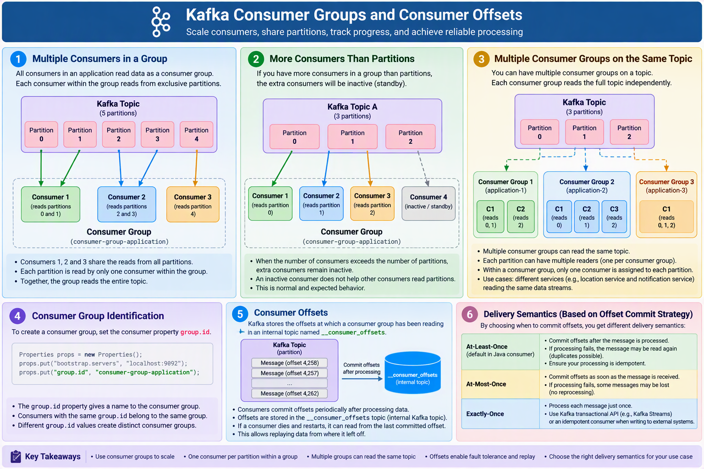

# 2.4 Consumer groups and consumer offsets



## Consumer Groups

A **consumer group** is a collection of consumers that work together to read data from a Kafka topic. Kafka distributes topic partitions among consumers in the same group to enable scalability and parallel processing.

### Example: 5 Partitions, 3 Consumers

- Topic has 5 partitions (0–4).
- Consumer Group contains 3 consumers.

Partition assignment may look like:

| Consumer | Partitions |
|----------|------------|
| Consumer 1 | 0, 1 |
| Consumer 2 | 2, 3 |
| Consumer 3 | 4 |

**Key Rule:** Within the same consumer group, each partition is assigned to only one consumer.

## More Consumers Than Partitions

If a topic has 3 partitions and the consumer group has 4 consumers:

| Consumer | Status |
|----------|--------|
| Consumer 1 | Active |
| Consumer 2 | Active |
| Consumer 3 | Active |
| Consumer 4 | Inactive (standby) |

Important:
- Kafka does not allow multiple consumers in the same group to share a partition.
- Extra consumers remain idle until rebalancing occurs.

## Multiple Consumer Groups

A single topic can serve multiple consumer groups.

Example:

### Consumer Group 1
- 2 consumers share all partitions.

### Consumer Group 2
- 3 consumers read one partition each.

### Consumer Group 3
- 1 consumer reads all partitions.

Each consumer group receives its own copy of the data stream.

### Common Use Case
A truck GPS topic can be consumed by:

- **Location Service** (Consumer Group A)
- **Notification Service** (Consumer Group B)

Each service processes the same messages independently.

## Group ID

Consumer groups are identified using the **group.id** consumer property.

Consumers with the same `group.id` belong to the same consumer group.

---

# Consumer Offsets


A **consumer offset** represents the position of a consumer within a partition.

Kafka stores committed offsets in an internal topic:

```text
__consumer_offsets
```

## Why Offsets Matter

Consumers periodically commit offsets after processing messages.

This allows Kafka to remember:

- How much data has been processed.
- Where consumption should resume after a restart.

### Example

If a consumer commits offset **4262** for a partition:

1. Consumer crashes.
2. Consumer restarts.
3. Kafka resumes delivery from offset 4262 onward.

This provides fault tolerance and recovery.

---

# Offset Commit Process

1. Consumer reads records.
2. Consumer processes records.
3. Consumer commits offsets.
4. Kafka stores offsets in `__consumer_offsets`.

Committed offsets act as checkpoints.

---

# Delivery Semantics

The timing of offset commits determines message delivery guarantees.

## 1. At-Least-Once

### Behavior
- Process message first.
- Commit offset afterward.

### Advantage
- Messages are not lost.

### Drawback
- Failures may cause a message to be processed more than once.

### Requirement
- Processing should be **idempotent** (safe to execute multiple times).

---

## 2. At-Most-Once

### Behavior
- Commit offset immediately after receiving the message.
- Process message afterward.

### Advantage
- No duplicate processing.

### Drawback
- Messages can be lost if processing fails after the offset is committed.

---

## 3. Exactly-Once

### Goal
- Process each message exactly one time.

### Implementation
- Kafka-to-Kafka workflows can use Kafka's transactional APIs.
- Kafka Streams provides built-in support for this model.
- External systems typically require idempotent consumers and careful transaction handling.

### Advantage
- No data loss.
- No duplicate processing.

---

# Key Takeaways

- Consumer groups enable scalable parallel consumption.
- A partition can be assigned to only one consumer within the same group.
- Additional consumers beyond the partition count remain idle.
- Multiple consumer groups can independently consume the same topic.
- Kafka stores offsets in the internal `__consumer_offsets` topic.
- Offsets allow consumers to resume processing after failures.
- Offset commit strategy determines delivery semantics:
  - **At-Least-Once:** No loss, possible duplicates.
  - **At-Most-Once:** No duplicates, possible loss.
  - **Exactly-Once:** No loss and no duplicates.


## [Context](./../../context.md)