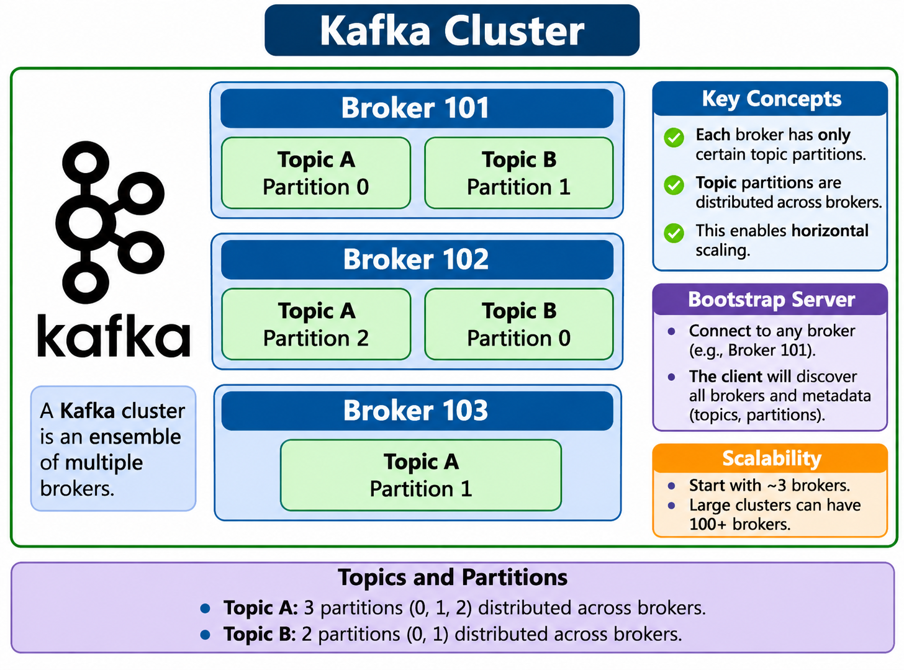
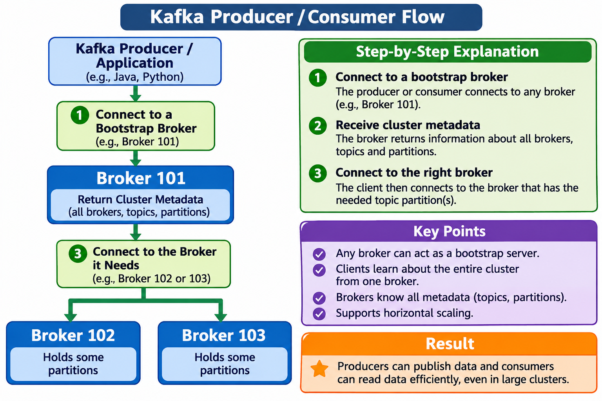

# 2.5 Brokers and topics

## 1. What is a Kafka broker?

A **Kafka broker** is a server that receives, stores, and sends data. A
group of brokers working together is called a **Kafka cluster**.

-   Every broker has a unique integer ID, such as `101`, `102`, or
    `103`.
-   Each broker stores only the topic partitions assigned to it.
-   A cluster can start with a few brokers and grow to more than 100 in
    large deployments.
-   Three brokers are a useful starting point for learning and small
    example clusters.

## 2. Topics and partitions are distributed across brokers

A **topic** is a named stream of data. Kafka divides a topic into
**partitions** so that data can be distributed across multiple brokers.

In the lecture's example:

-   Topic A has three partitions: `A-0`, `A-1`, and `A-2`.
-   Topic B has two partitions: `B-0` and `B-1`.
-   The cluster has three brokers: `101`, `102`, and `103`.

Example placement:

  | Kafka broker | Topic partitions stored                      |
  |--------------|----------------------------------------------|
  | Broker 101   | Topic A - Partition 0; Topic B - Partition 1 |
  | Broker 102   | Topic A - Partition 2; Topic B - Partition 0 |
  | Broker 103   | Topic A - Partition 1                        |

The partition numbers do not need to be placed in numerical order across
brokers. Broker 103 has no Topic B partition in this example because
Topic B has only two partitions, and both have already been assigned to
other brokers.

### Simple layout

* Three Kafka brokers (101, 102, 103).
* Topic A with three partitions.
* Topic B with two partitions.
* Explanation of partition distribution.
* Bootstrap server and broker discovery.
* Horizontal scaling.
* Key Kafka concepts and terminology.

**Important:** A broker does not necessarily store every partition or
all the data in the cluster. Each broker stores the partitions assigned
to it.

## 3. Horizontal scaling

Kafka supports **horizontal scaling** by distributing partitions across
multiple brokers.

For example:

1.  Add more partitions to distribute a topic's data and workload.
2.  Add more brokers to provide additional cluster capacity.
3.  Assign partitions across the brokers.

This distribution allows Kafka to handle more data and more client
activity as a cluster grows. The exact capacity and performance depend
on the workload and cluster configuration.

## 4. Bootstrap servers and broker discovery

A Kafka client does not need to know every broker in advance. It can
initially connect to one broker, called a **bootstrap server**.

In fact, every broker in the cluster can serve as a bootstrap server.

The connection process works like this:

1.  The producer or consumer starts with the address of one Kafka
    broker.
2.  The client connects to that broker and requests cluster metadata.
3.  The broker returns metadata, including the brokers in the cluster
    and information about topic partitions.
4.  The client uses this metadata to connect to the appropriate broker
    for the operation it needs to perform.

* Producer / Consumer – the application connecting to Kafka.
* Bootstrap Broker – initial connection to Broker 101.
* Cluster Metadata – broker, topic, and partition information returned to the client.
* Broker Discovery – the client identifies which broker it needs.
* Broker 102 and 103 – the client connects to the appropriate broker.

This is why Kafka client configuration commonly includes a setting named
`bootstrap.servers`. It provides one or more initial broker addresses;
it does not have to list every broker in the cluster.

## 5. What metadata does a broker know?

Kafka brokers maintain cluster metadata, including information about:

-   The brokers that belong to the cluster.
-   The topics in the cluster.
-   The partitions belonging to those topics.
-   Which brokers host particular partitions.

The client uses this information to discover where it should send or
retrieve data.

## 6. Key terms

 
  | Term                   | Meaning                                                                         |
  |------------------------|---------------------------------------------------------------------------------|
  | **Broker**             | A Kafka server that stores and serves assigned partitions.                      |                                  
  | **Cluster**            | A group of Kafka brokers working together.                                      |                                  
  | **Topic**              | A named stream or category of data.                                             |
  | **Partition**          | A portion of a topic used to distribute data and workload.                      |                                 
  | **Bootstrap server**   | A broker address a client uses to make its initial connection.                  |                               
  | **Metadata**           | Information about the cluster, brokers, topics, and partitions.                 |                               
  | **Horizontal scaling** | Increasing capacity by adding resources, such as brokers, across a cluster.     |
                                      
                                      
## 7. Main points to remember

-   A Kafka cluster consists of multiple brokers.
-   Each broker has a unique ID.
-   Topics are divided into partitions.
-   Partitions are distributed across brokers; a broker does not need to
    hold every partition.
-   Distributing partitions across brokers helps Kafka scale
    horizontally.
-   A client can connect to one bootstrap server to discover the rest of
    the cluster.
-   Producers and consumers use cluster metadata to find the brokers
    they need.
-   `bootstrap.servers` is a common Kafka client configuration setting.

## 8. Quick knowledge check

1.  **What is a Kafka broker?**\
    A server that stores and serves the topic partitions assigned to it.

2.  **What is a Kafka cluster?**\
    A group of Kafka brokers working together.

3.  **Why does Kafka use partitions?**\
    To divide topic data so it can be distributed and processed across
    brokers.

4.  **Does every broker store every topic partition?**\
    No. Brokers store only the partitions assigned to them.

5.  **What is a bootstrap server?**\
    An initial broker address a client connects to so it can discover
    the cluster.

6.  **What does `bootstrap.servers` configure?**\
    The initial broker addresses used by a Kafka client to connect to
    the cluster.

## [Context](./../../context.md)