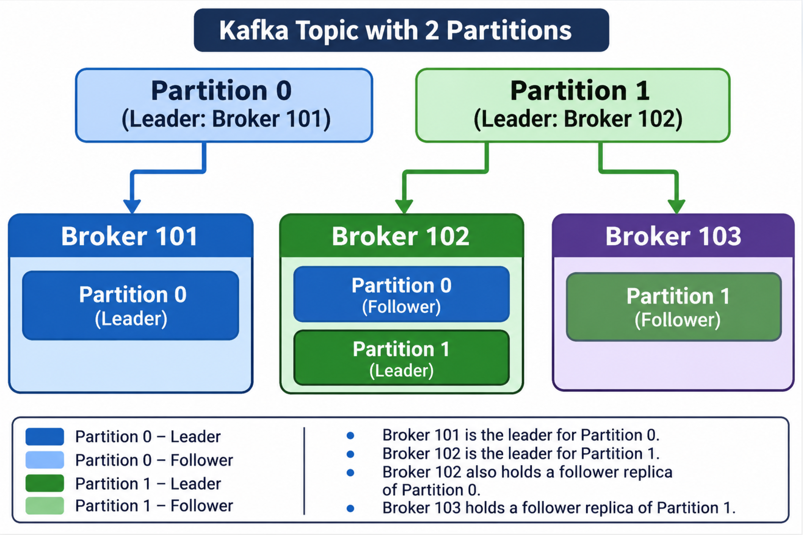
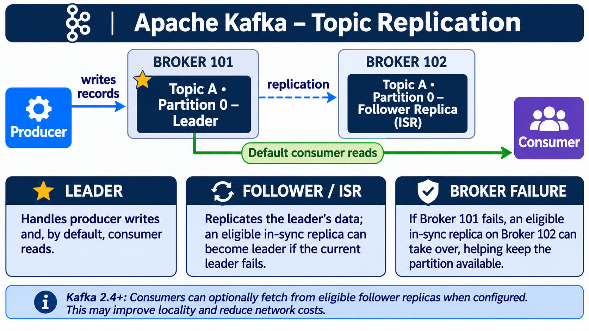

# 2.6 Topic replication

## Overview

Kafka topic replication protects data availability by keeping copies of
each partition on multiple brokers. If a broker fails or is taken
offline, another broker can continue serving the partition.

-   **Local development:** A replication factor of `1` is often
    sufficient.
-   **Production:** Use a replication factor greater than `1`, commonly
    `2` or `3`.
-   **Common production choice:** A replication factor of `3` provides
    stronger fault tolerance.

## Partitions and Replication Factor

A **replication factor** is the number of copies Kafka maintains for
each partition, including the original copy.

Example:

-   Topic A has **2 partitions**.
-   Its replication factor is **2**.
-   Kafka stores two copies of each partition across brokers.
-   This results in **4 partition copies** in total.

With three brokers, the copies might be distributed like this:

  Broker       Partition copies
  ------------ ---------------------------------------------
  Broker 101   Partition 0 (leader)
  Broker 102   Partition 1 (leader), Partition 0 (replica)
  Broker 103   Partition 1 (replica)

The exact placement is managed by Kafka, but replicas are distributed
across brokers so that a single broker failure does not necessarily make
the data unavailable.

## What Happens When a Broker Fails?

If Broker 102 goes down in this example:

-   Partition 0 remains available on Broker 101.
-   Partition 1 has a replica on Broker 103.
-   Kafka can continue serving both partitions, provided the remaining
    replicas are available and eligible to become leaders.

With a replication factor of `2`, Kafka can generally tolerate the loss
of one broker for a partition when its other replica is available.
Replication improves availability, but it is not a substitute for
backups or a disaster-recovery plan.

## Leaders and Replicas

Each partition has one **leader replica** at a time. Other copies are
called **follower replicas**.

-   **Leader:** Handles the partition's normal read and write traffic by
    default.
-   **Follower replica:** Copies data from the leader and can take over
    if the leader becomes unavailable and Kafka elects it.
-   Only one broker is the leader for a particular partition at a time.

In the example:

-   Broker 101 is the leader for Partition 0.
-   Broker 102 is the leader for Partition 1.
-   Broker 102 also holds a follower replica of Partition 0.
-   Broker 103 holds a follower replica of Partition 1.

 

## In-Sync Replicas (ISR)

An **In-Sync Replica (ISR)** is a replica that is sufficiently up to
date with its partition leader according to Kafka's replication rules.

-   Replicas that keep up with the leader are part of the ISR.
-   Replicas that fall too far behind can be removed from the ISR until
    they catch up.
-   ISR status matters for Kafka's durability and leader-election
    behavior.

## How Producers and Consumers Use Replicas

By default:

-   **Producers write to the leader** of the partition they are sending
    records to.
-   **Consumers read from the leader** of a partition.
-   Follower replicas continuously replicate the leader's data so they
    can help maintain availability if a leader fails.

For example, a producer sending a record to Partition 0 sends it to that
partition's leader, Broker 101. The follower replica on Broker 102
copies the data.

## Consumer Replica Fetching (Kafka 2.4+)

Kafka 2.4 introduced the ability for consumers to fetch records from
eligible follower replicas, rather than always fetching from the leader.
This is commonly called **follower fetching** or **consumer replica
fetching**.

Potential benefits include:

-   **Lower latency:** A consumer may be able to read from a replica
    closer to it.
-   **Lower network costs:** In cloud deployments, reading from a nearby
    replica may reduce cross-zone or cross-region data transfer.

This behavior depends on Kafka configuration and the availability of
suitable replicas. It is an additional option; the traditional default
is for consumers to read from partition leaders.

## Key Takeaways

1.  Replication creates copies of topic partitions on multiple Kafka
    brokers.
2.  The replication factor determines how many copies Kafka maintains
    for each partition.
3.  A replication factor of `2` creates two copies; a replication factor
    of `3` creates three.
4.  Each partition has one leader, while the other replicas follow it.
5.  Producers write to the leader by default, and consumers
    traditionally read from the leader.
6.  In-Sync Replicas are replicas that are sufficiently caught up with
    the leader.
7.  Replication helps Kafka remain available when a broker fails.
8.  Kafka 2.4+ can allow consumers to fetch from follower replicas,
    which may improve locality and reduce network costs.

## Important Terms

  | Term                             | Meaning                                                              |
  |----------------------------------|----------------------------------------------------------------------|
  | Broker                           | A Kafka server that stores and serves partition data.                |                       
  | Topic                            | A named stream of records in Kafka.                                  |
  | Partition                        | A topic's ordered, divided unit of storage and parallelism.          |                               
  | Replication factor               | Number of copies maintained for each partition.                      |                   
  | Leader                           | The replica that handles normal reads and writes by default.         |                        
  | Follower                         | A replica that copies data from the leader.                          |
  | ISR                              | In-Sync Replica; a replica sufficiently caught up with the leader.   |                         
  | Follower fetching                | Allowing consumers to read from eligible follower replicas.          |
                                      
  
Kafka topic replication, the leader/follower relationship, in-sync replicas (ISR), and what happens when a broker fails.
 
 
  
The three most important concepts to remember for your Kafka certification studies are:
1. Leader: Handles writes and normally handles consumer reads.
2. Follower: Replicates the leader's data.
3. ISR: Replicas sufficiently caught up to participate in safe leader election.

## [Context](./../../context.md)