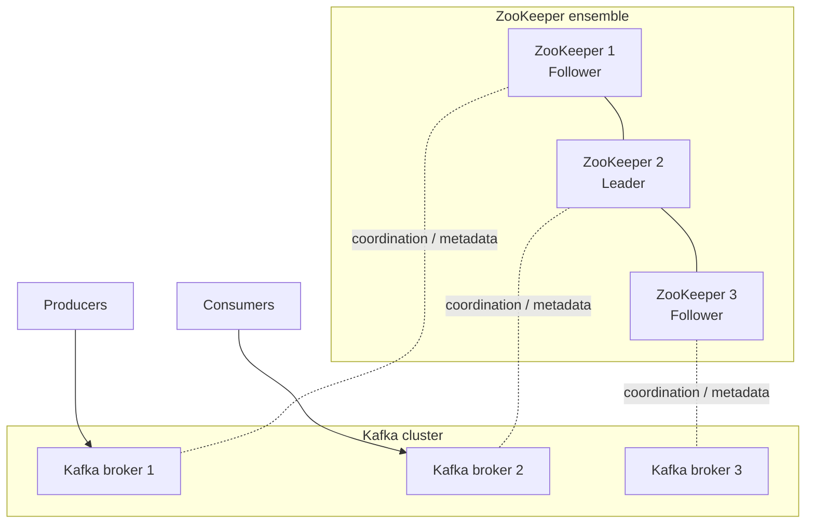
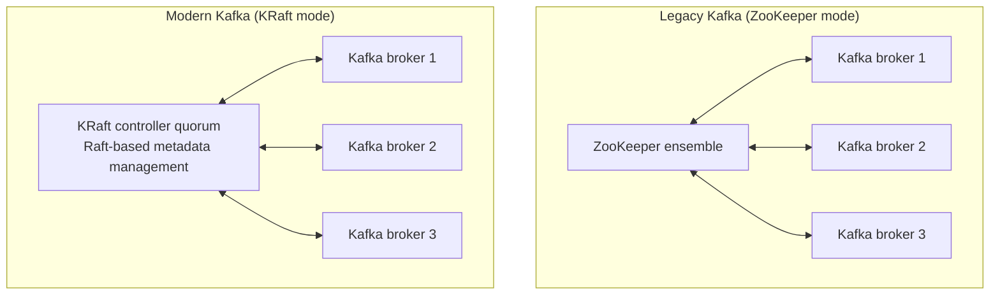

# 2.8 ZooKeeper

## 1. What is ZooKeeper?

**Apache ZooKeeper** is a distributed coordination service. In older Kafka architectures, Kafka used ZooKeeper to coordinate brokers and maintain important cluster metadata.

ZooKeeper helped Kafka keep track of:
- Which Kafka brokers were members of the cluster.
- Broker availability and changes in cluster membership.
- Metadata needed for cluster coordination.
- Coordination related to partition leadership changes.

ZooKeeper was a separate service. In a traditional deployment, the ZooKeeper ensemble had to be running for the Kafka brokers to operate.

## 2. Kafka architecture with ZooKeeper

A common deployment used three ZooKeeper servers and multiple Kafka brokers.



**How to read the diagram:**
1. ZooKeeper servers form an ensemble and coordinate with one another.
2. One ZooKeeper server acts as leader; the others act as followers.
3. Kafka brokers use ZooKeeper for coordination and metadata in the legacy architecture.
4. Producers and consumers communicate with Kafka brokers, not directly with ZooKeeper in modern client applications.

The diagram is conceptual: Kafka brokers can connect to the ZooKeeper ensemble, and clients can connect to any suitable Kafka broker.

## 3. ZooKeeper's responsibilities in legacy Kafka

### Broker registration and tracking

ZooKeeper maintained information about Kafka brokers in the cluster. It helped the cluster detect when brokers joined or became unavailable.

### Partition leader coordination

A Kafka topic is divided into partitions. Each partition has a leader replica and may have follower replicas.

In the legacy ZooKeeper architecture, ZooKeeper participated in the controller and leader-election coordination process. If a broker failed, Kafka needed to determine which eligible replica should become the new leader.

> The broker/controller logic performs Kafka's partition leadership decisions; ZooKeeper provides coordination support in the legacy architecture.

### Change notifications

ZooKeeper could notify Kafka components about changes, such as:
- A broker joining or leaving the cluster.
- Topic creation or deletion.
- Changes to cluster metadata.

## 4. ZooKeeper does not store modern consumer offsets

An important distinction from older tutorials:

- Very old Kafka versions stored consumer offsets in ZooKeeper.
- Since Kafka 0.9, consumer offsets have been stored in Kafka itself.
- Modern Kafka stores committed consumer-group offsets in the internal topic named `__consumer_offsets`.

**Remember:** ZooKeeper is not where modern Kafka consumer offsets are stored.

## 5. ZooKeeper ensemble: leader and followers

ZooKeeper is commonly deployed as an ensemble with an odd number of servers, such as:
- 1 server — useful for development or testing, but no fault tolerance.
- 3 servers — can tolerate 1 server failure.
- 5 servers — can tolerate 2 server failures.
- 7 servers — can tolerate 3 server failures.

A ZooKeeper ensemble uses a **quorum**, meaning a majority of its servers must be available to make progress. For example, a three-server ensemble needs two servers available.

ZooKeeper uses leader/follower coordination. The leader handles the coordination role for writes, while followers can serve reads and participate in consensus.

## 6. KRaft: Kafka without ZooKeeper

Kafka is moving away from ZooKeeper and uses **KRaft**, which stands for **Kafka Raft**.

KRaft uses the Raft consensus protocol and Kafka's own controller quorum to manage cluster metadata. This removes the need to operate a separate ZooKeeper ensemble.

### Legacy architecture versus KRaft



| Area | ZooKeeper mode | KRaft mode |
|---|---|---|
| Cluster metadata | Managed with ZooKeeper coordination | Managed by Kafka's KRaft controller quorum |
| Separate ZooKeeper service | Required | Not required |
| Consensus / coordination | ZooKeeper ensemble | Raft-based controller quorum |
| Operations | Maintain Kafka and ZooKeeper | Maintain Kafka |
| Kafka 4.x | Not supported | Required |

## 7. Kafka version timeline — important update

The lecture describes the transition as if ZooKeeper removal were still in the future. That part is now outdated.

| Kafka version | ZooKeeper / KRaft status |
|---|---|
| Kafka 2.x and earlier | Traditional ZooKeeper-based architecture |
| Kafka 3.x | KRaft introduced and developed; ZooKeeper mode continued to be supported in 3.x |
| Kafka 3.3 | KRaft considered production-ready |
| Kafka 4.0 and later | ZooKeeper mode removed; KRaft is required |

**Practical takeaway:** New Kafka 4.x deployments use KRaft. Existing ZooKeeper-based clusters must be migrated to KRaft before upgrading to Kafka 4.x. Follow the official upgrade and migration instructions for the exact versions involved.

## 8. How Kafka clients connect

Modern Kafka applications connect to Kafka brokers using a bootstrap server address.

Examples include:
- Producers
- Consumers
- Kafka administration clients
- Kafka command-line tools

Example client setting:

```properties
bootstrap.servers=localhost:9092
```

Do not configure modern Kafka producers or consumers to connect directly to ZooKeeper. Clients obtain the cluster information they need through Kafka's broker APIs.

Older tutorials and configurations may still mention ZooKeeper. Treat those instructions as version-specific legacy material.

## 9. Important terms

| Term | Meaning |
|---|---|
| ZooKeeper | Distributed coordination service used by legacy Kafka clusters |
| Ensemble | A group of ZooKeeper servers working together |
| Quorum | Majority of ensemble members required for progress |
| Leader | Server responsible for coordinating the ensemble's writes |
| Follower | ZooKeeper server that follows the leader and participates in the ensemble |
| Broker | A Kafka server that stores and serves topic partitions |
| Partition | An ordered, independently replicated portion of a Kafka topic |
| Replica | A copy of a partition hosted on a broker |
| Controller | Kafka component responsible for cluster-level coordination |
| KRaft | Kafka's built-in Raft-based metadata management mode |
| `__consumer_offsets` | Internal Kafka topic that stores committed consumer-group offsets |

## 10. Key points to remember

1. ZooKeeper was a separate coordination service used by legacy Kafka clusters.
2. It tracked broker membership and supported cluster coordination and metadata management.
3. ZooKeeper helped with the coordination involved in broker and partition leadership changes.
4. A ZooKeeper ensemble normally uses an odd number of servers and requires a quorum.
5. Modern Kafka consumer offsets are stored in `__consumer_offsets`, not ZooKeeper.
6. Modern Kafka clients connect to Kafka brokers, not directly to ZooKeeper.
7. KRaft replaces ZooKeeper with Kafka's own Raft-based controller quorum.
8. Kafka 4.0 and later require KRaft; ZooKeeper mode has been removed.

## 11. Review questions

**1. What was ZooKeeper used for in legacy Kafka?**

It coordinated broker membership, cluster metadata, and activities related to partition leadership.

**2. Does ZooKeeper store modern Kafka consumer offsets?**

No. Committed consumer-group offsets are stored in Kafka's internal `__consumer_offsets` topic.

**3. Why use an odd number of ZooKeeper servers?**

An odd-sized ensemble makes majority quorum behavior straightforward. A majority must be available for the ensemble to make progress.

**4. What is KRaft?**

KRaft is Kafka's built-in Raft-based approach to managing cluster metadata without ZooKeeper.

**5. Should a modern Kafka producer connect to ZooKeeper?**

No. It should connect to Kafka brokers using `bootstrap.servers`.

**6. Does Kafka 4.x support ZooKeeper mode?**

No. Kafka 4.0 removed ZooKeeper mode and requires KRaft.

---

## Official references

- [Apache Kafka 4.0 release announcement](https://kafka.apache.org/blog/2025/03/18/apache-kafka-4.0.0-release-announcement/)
- [Apache Kafka upgrade documentation](https://kafka.apache.org/40/getting-started/upgrade/)
- [KIP-500: Replace ZooKeeper with a Self-Managed Metadata Quorum](https://cwiki.apache.org/confluence/display/KAFKA/KIP-500%3A+Replace+ZooKeeper+with+a+Self-Managed+Metadata+Quorum)

## [Context](./../../context.md)