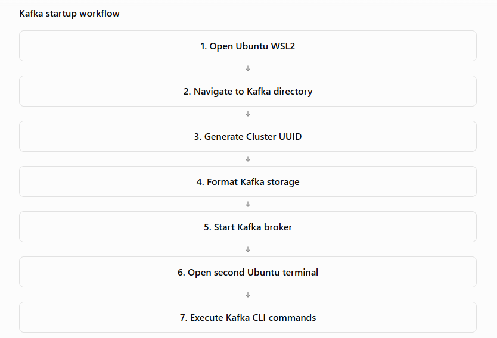

# 3.10 Windows WSL2- Start Kafka in KRaft mode

This lecture demonstrates how to start a **single-node Apache Kafka broker in KRaft mode** inside Ubuntu on Windows WSL2. KRaft removes the need to run ZooKeeper separately. The workflow is to enter the Kafka installation directory, generate a cluster ID, format the broker's storage **once**, and start the server.

## Prerequisites

- Windows with WSL2 and Ubuntu installed.
- Java and Apache Kafka binaries installed inside Ubuntu (covered in the previous lecture).
- Kafka CLI commands available through the configured `PATH`, or run them from Kafka's `bin/` directory.

## Step-by-step instructions

### 1. Navigate to the Kafka directory

Open Ubuntu (WSL2) and change to your extracted Kafka directory. Replace the directory name with your installed version:

```bash
cd ~/kafka_2.13-4.0.0
```

### 2. Generate a unique cluster ID

```bash
KAFKA_CLUSTER_ID="$(bin/kafka-storage.sh random-uuid)"
echo "$KAFKA_CLUSTER_ID"
```

This generates an ID for the new KRaft cluster and stores it in a shell variable.

### 3. Inspect Kafka's configuration

```bash
cat config/server.properties
```

Look for `log.dirs`, which determines where Kafka stores its broker data. The lecture's example uses:

```properties
log.dirs=/tmp/kraft-combined-logs
```

**Note:** `/tmp` is appropriate for disposable practice data, but is not a durable production storage location. The exact default may differ with the Kafka distribution or configuration.

### 4. Format the storage directory (initial setup only)

```bash
bin/kafka-storage.sh format \
  -t "$KAFKA_CLUSTER_ID" \
  -c config/server.properties
```

This initializes the configured storage with the cluster ID. **Do not repeat formatting on each restart** or casually reinitialize existing Kafka data.

### 5. Start the Kafka server

```bash
bin/kafka-server-start.sh config/server.properties
```

Watch the log output for successful startup. Keep this Ubuntu terminal open while the broker runs.

### 6. Open a second Ubuntu terminal and verify

```bash
kafka-topics.sh --bootstrap-server localhost:9092 --list
```

If the broker is listening on the configured address, this lists available topics. An empty list can be normal for a new cluster.

## Commands at a glance

| Command | Purpose |
| --- | --- |
| `cd ~/kafka_2.13-4.0.0` | Enter the Kafka installation directory (example version) |
| `bin/kafka-storage.sh random-uuid` | Generate a KRaft cluster ID |
| `cat config/server.properties` | Inspect broker configuration |
| `bin/kafka-storage.sh format -t "$KAFKA_CLUSTER_ID" -c config/server.properties` | Initialize storage once |
| `bin/kafka-server-start.sh config/server.properties` | Start Kafka |
| `kafka-topics.sh --bootstrap-server localhost:9092 --list` | Check the broker using Kafka CLI |

## Important notes

- **KRaft** is Kafka's built-in metadata quorum mechanism, replacing ZooKeeper.
- **Cluster ID** identifies the Kafka cluster.
- **`config/server.properties`** contains the broker's settings, including `log.dirs`.
- **Temporary storage** under `/tmp` can be cleared, resulting in lost practice data.
- **Two terminals** are useful: one keeps Kafka running; the other runs Kafka CLI commands.
- **Manual setup vs. Docker:** This lecture starts Kafka directly inside WSL2, rather than via Docker Compose and Conduktor.

## Troubleshooting

- **`command not found`:** Check your Kafka directory or ensure its `bin` directory is in `PATH`.
- **Java errors:** Confirm Java is installed using `java --version`.
- **Cannot connect to `localhost:9092`:** Confirm the Kafka server is running and check its configured listener and port.
- **Storage already formatted:** Do not reformat; start Kafka with the existing configuration and storage.

## Key takeaway

To start Kafka in KRaft mode on Windows WSL2, generate a cluster ID, initialize storage once, and start Kafka using `config/server.properties`. Keep the server terminal open and use a separate Ubuntu terminal for Kafka CLI commands.


## Key concepts
1. KRaft mode: Start Apache Kafka without ZooKeeper.
2. Cluster UUID: Generate a unique identifier for the Kafka cluster.
3. Format storage: Initialize Kafka's log directory before its first startup.
4. Kafka configuration: Use config/server.properties to configure the broker.
5. Start Kafka: Launch the Kafka server directly inside Ubuntu WSL2.
6. Kafka CLI: Use a second Ubuntu terminal to execute Kafka commands.
## Important Kafka commands
**Step 1: Navigate to the Kafka directory**
```bash
cd ~/kafka_2.13-4.0.0
```

**Step 2: Generate a Cluster UUID**
```bash
KAFKA_CLUSTER_ID="$(bin/kafka-storage.sh random-uuid)"
```

**Step 3: Format Kafka storage**
```bash
bin/kafka-storage.sh format \
  -t "$KAFKA_CLUSTER_ID" \
  -c config/server.properties
```

Only format storage during initial setup.

**Step 4: Start Kafka**
```bash
bin/kafka-server-start.sh config/server.properties
```

**Step 5: Verify Kafka is running**

Open a second Ubuntu terminal:
```bash
kafka-topics.sh \
  --bootstrap-server localhost:9092 \
  --list
```




## [Context](./../../context.md)