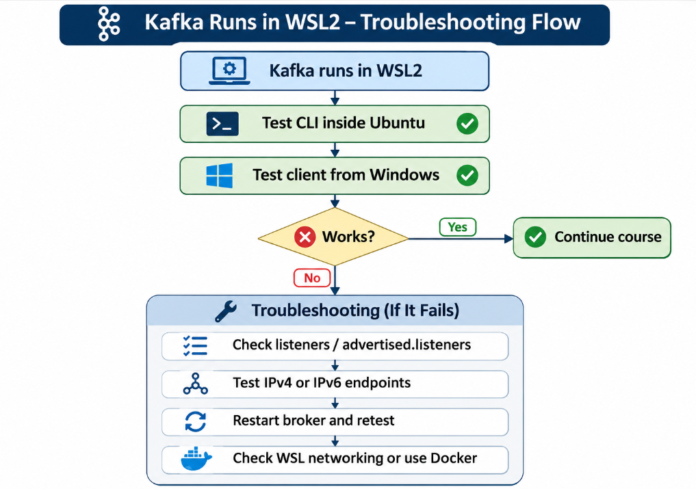

# 3.11 Windows WSL2- How to fix problems

This lecture explains a Kafka networking issue that can occur when Kafka runs inside Windows Subsystem for Linux 2 (WSL2). Kafka commands may work inside Ubuntu but fail when invoked from Windows PowerShell, Java applications, or Conduktor. The instructor describes two approaches involving IPv6 and Kafka listener configuration.

## Symptoms

- Kafka starts successfully inside Ubuntu on WSL2.
- `kafka-topics.sh` works inside Ubuntu.
- A client running outside WSL2 reports broker/node unavailable errors, even when using `localhost:9092`.
- The issue may relate to how `localhost`, IPv4, IPv6, and Kafka's advertised broker address are resolved across the Windows/WSL2 boundary.

> **Important:** A successful bootstrap connection does not guarantee a Kafka client can connect to the broker address returned in metadata. Check `advertised.listeners` as well as `listeners` if the problem persists.

## First: Check Kafka connectivity

From the Ubuntu terminal, with Kafka running:

```bash
kafka-topics.sh --bootstrap-server localhost:9092 --list
```

If this works inside WSL2 but not from Windows, focus on Windows-to-WSL2 connectivity and listener settings.

## Fix 1: Use an explicit IPv4 listener

1. Stop the Kafka broker (`Ctrl+C` in the terminal where it is running).
2. Open the broker configuration file from the Kafka installation directory:

   ```bash
   nano config/server.properties
   ```

3. For the client listener, use the explicit IPv4 loopback address where appropriate:

   ```properties
   listeners=PLAINTEXT://127.0.0.1:9092
   advertised.listeners=PLAINTEXT://localhost:9092
   ```

   **Caution:** Kafka 4.x KRaft configurations may have multiple listeners, including a controller listener. Do not replace or remove required controller listener entries. Adapt the existing configuration rather than copying these lines over the complete listener configuration. `advertised.listeners` must point to an address clients can actually reach.

4. Save the file, restart Kafka, and test from both Ubuntu and Windows.

### About disabling IPv6

The instructor also demonstrates temporarily disabling IPv6 inside WSL2 as a possible workaround. This is a system-wide network change and is **not the recommended first step**: prefer fixing listener and address configuration. If needed, use the exact instructions for your WSL2 version and understand that a temporary `sysctl` change may be lost after a restart. If IPv6 is already disabled, there is nothing to change.

## Fix 2: Use IPv6 loopback instead

If you prefer IPv6, the loopback address is `::1`. Kafka listener syntax for an IPv6 literal uses square brackets:

```properties
listeners=PLAINTEXT://[::1]:9092
```

Clients must then use a matching reachable IPv6 endpoint, for example:

```bash
kafka-topics.sh --bootstrap-server '[::1]:9092' --list
```

As with the IPv4 option, preserve any required KRaft controller listeners and ensure the broker's advertised endpoint is reachable by the actual clients. IPv6 loopback inside WSL2 may **not** be reachable in the same way from Windows; verify connectivity from the client environment.

## If the problem continues

- Confirm Kafka is running and listening on the intended port.
- Review `listeners` and `advertised.listeners` in `config/server.properties`.
- Confirm whether the client runs inside Ubuntu or on Windows; `localhost` can behave differently depending on WSL networking mode.
- Verify the Kafka client is using the intended bootstrap endpoint.
- Check WSL2 and Windows networking/firewall settings.
- Consider running the course's Docker Compose Kafka + Conduktor stack as an alternative.

## Key takeaways

1. Kafka may work inside WSL2 but fail for clients running on Windows.
2. The lecture presents two IPv6-related workarounds: an IPv4-oriented configuration and an IPv6-loopback configuration.
3. Stop Kafka before editing its configuration, then restart it.
4. Test clients from the **same environment** where they will actually run.
5. Listener and advertised-listener configuration often matters more than disabling IPv6.
6. Docker Compose with Conduktor is an alternative if WSL2 networking remains problematic.

## Example troubleshooting workflow



## Notes

- The transcript describes an older ZooKeeper-based example in places, although earlier course lessons use KRaft. Follow the listener conventions appropriate to your Kafka version.
- The transcript does not provide the literal commands used to disable and re-enable IPv6; they are intentionally not invented here.
- `localhost:9092` is the expected course endpoint in many examples, but your actual address depends on broker configuration and WSL2 networking.


## [Context](./../../context.md)