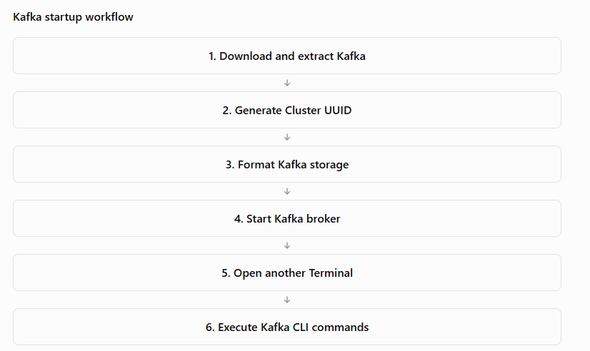

# 3.4 macOS X- Start Kafka in KRaft mode

## Overview
This lecture demonstrates how to start a local Apache Kafka broker on macOS using **KRaft mode**, which does not require ZooKeeper. It assumes Kafka binaries have already been downloaded and extracted.

## Steps to Start Kafka

### 1. Open Terminal and enter the Kafka directory
```bash
cd ~/kafka_2.13-4.0.0
```
Replace the example folder name with the directory where you extracted Kafka.

### 2. Generate a cluster ID
```bash
KAFKA_CLUSTER_ID="$(bin/kafka-storage.sh random-uuid)"
echo "$KAFKA_CLUSTER_ID"
```
This creates a unique cluster identifier and stores it in a shell variable.

### 3. Format Kafka storage
```bash
bin/kafka-storage.sh format -t "$KAFKA_CLUSTER_ID" -c config/server.properties
```
This initializes the local storage directories using the cluster ID and Kafka configuration. **Do this only when initializing a new storage directory**, not every time Kafka restarts.

### 4. Review the server configuration (optional)
```bash
nano config/server.properties
```
The `server.properties` file controls settings such as broker configuration and the `log.dirs` location. The course's example uses a temporary KRaft log directory. A temporary directory is unsuitable for durable data because its contents may be cleared.

### 5. Start the Kafka broker
```bash
bin/kafka-server-start.sh config/server.properties
```
Wait for the server startup confirmation in Terminal. Keep this Terminal window open while Kafka is running.

### 6. Open another Terminal to run Kafka CLI commands

If Kafka CLI tools are on your `PATH`, you can use:
```bash
kafka-topics.sh --bootstrap-server localhost:9092 --list
```
Or from the Kafka directory:
```bash
bin/kafka-topics.sh --bootstrap-server localhost:9092 --list
```
This lists the available Kafka topics on the local broker.

## Key Concepts
- **KRaft:** Kafka's built-in metadata quorum mode; ZooKeeper is not needed.
- **Cluster ID:** Unique identifier for the Kafka cluster.
- **Storage formatting:** Initializes Kafka's local storage before the first startup.
- **`server.properties`:** Configuration file used to start the broker.
- **`log.dirs`:** Location where Kafka stores broker data and logs.
- **Two terminals:** One runs the Kafka server; the other runs CLI commands.

## Important Notes
- The lecture demonstrates a **single-broker local development setup**, not a production cluster.
- Avoid storing important Kafka data in temporary directories.
- If Kafka is already running via Docker on port `9092`, stop that broker or adjust ports before starting another local broker.
- The exact configuration file paths can differ across Kafka releases; these commands match the `config/server.properties` layout described in the lecture.
- To stop the foreground Kafka server, press **Ctrl+C** in its Terminal window.

## Quick Reference
| Task | Command |
|---|---|
| Generate cluster ID | `bin/kafka-storage.sh random-uuid` |
| Initialize storage | `bin/kafka-storage.sh format -t "$KAFKA_CLUSTER_ID" -c config/server.properties` |
| View configuration | `nano config/server.properties` |
| Start Kafka | `bin/kafka-server-start.sh config/server.properties` |
| List topics | `bin/kafka-topics.sh --bootstrap-server localhost:9092 --list` |

## Key concepts
1. KRaft Mode: Run Apache Kafka without ZooKeeper.
2. Cluster UUID: Generate a unique identifier for the Kafka cluster.
3. Format Storage: Initialize Kafka's log directory before its first startup.
4. Kafka Configuration: Use config/server.properties to configure the broker.
5. Start Kafka: Launch the Kafka server using the command line.
6. Kafka CLI: Open another Terminal window to execute Kafka commands.



## [Context](./../../context.md)