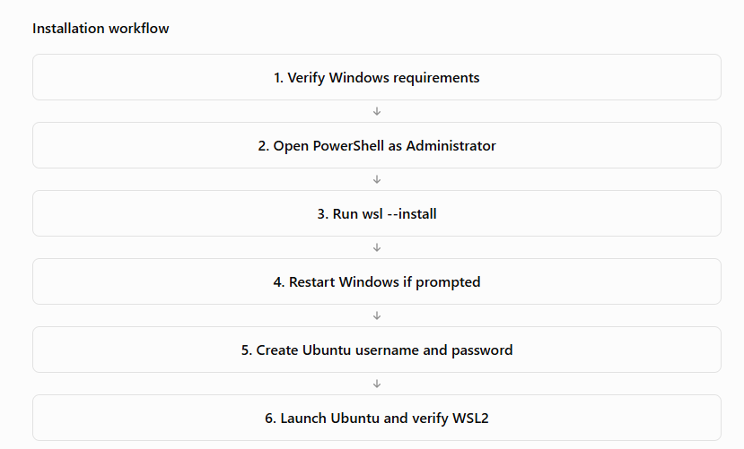

# 3.8 Windows WSL2- WSL2 Setup

This lecture explains how to install **Windows Subsystem for Linux 2 (WSL2)** and Ubuntu on Windows before installing Apache Kafka CLI tools. Even if Kafka and Conduktor already run through Docker, the instructor recommends installing WSL2 so Kafka command-line tools can be used in a Linux environment on Windows.

## Prerequisites

- **Windows 10 version 2004 or later** (with the required updates), or **Windows 11**.
- Administrator access to run PowerShell.
- An internet connection to download WSL and Ubuntu.

## Step-by-Step Installation

### 1. Open PowerShell as Administrator

1. Open the Windows Start menu.
2. Search for **PowerShell**.
3. Right-click it and select **Run as administrator**.

### 2. Install WSL

Run:

```powershell
wsl --install
```

This command enables the necessary Windows components and normally installs Ubuntu as the default Linux distribution. Wait for the installation to finish. **Restart Windows if prompted.**

### 3. Set Up Ubuntu

When Ubuntu launches for the first time:

1. Enter a new UNIX username.
2. Create a password.
3. Confirm the password.

The password may not appear while typing; this is normal.

### 4. Open Ubuntu Again

Search for **Ubuntu** in the Windows Start menu and launch it. The terminal now provides a Linux shell running under WSL.

### 5. Verify WSL2 (Recommended)

From PowerShell, run:

```powershell
wsl --list --verbose
```

Confirm that Ubuntu shows **VERSION 2**. If needed, convert it with:

```powershell
wsl --set-version Ubuntu 2
```

The distribution name may differ; use the exact name shown by `wsl --list --verbose`.

## Important Concepts

| Concept | Explanation |
|---|---|
| WSL | Windows Subsystem for Linux, which lets you run a Linux environment on Windows. |
| WSL2 | Uses a Linux kernel and is the recommended WSL version for this course. |
| Ubuntu | The Linux distribution installed in the lecture. |
| PowerShell | Windows command shell used to install and manage WSL. |
| Kafka CLI | Kafka command-line tools that will be installed in the next lecture. |
| Docker and Conduktor | May already run Kafka, but do not replace the course's separate CLI installation steps. |

## Useful Commands

```powershell
wsl --install
wsl --list --verbose
wsl --set-default-version 2
```

## Troubleshooting Notes

- If `wsl --install` requests a restart, restart Windows and then launch Ubuntu.
- If Ubuntu does not open immediately, find it in the Start menu.
- If WSL reports that virtualization is unavailable, check Windows virtualization requirements and firmware settings.
- The instructor recommends allowing installation time rather than repeatedly interrupting the process.

## Key Takeaway

**Install WSL2 and Ubuntu first, then install Java and Kafka binaries inside Ubuntu in the following lecture.** This gives Windows users a Linux terminal for running Kafka CLI commands, including when Kafka itself runs in Docker.
Key concepts
1. WSL2: Windows Subsystem for Linux allows you to run Linux directly within Windows.
2. Windows requirements: Windows 10 version 2004 or later, with required updates, or Windows 11.
3. Install WSL2: Use PowerShell with administrator privileges.
4. Ubuntu: The default Linux distribution installed through WSL.
5. Linux account: Create a UNIX username and password during initial setup.
6. Kafka CLI: WSL2 provides the Linux environment for installing and running Kafka command-line tools.


## Important commands
**Step 1: Open PowerShell as Administrator**

Run:
```bash
wsl --install
```

This installs WSL and normally installs Ubuntu.

**Step 2: Verify WSL2 installation**
```bash
wsl --list --verbose
```


Expected output resembles:
```
NAME      STATE      VERSION
Ubuntu    Running    2
```


**Step 3: Set WSL2 as the default version**
```bash
wsl --set-default-version 2
```



**Key takeaway:** WSL2 provides a Linux environment on Windows, allowing you to install and execute Apache Kafka CLI commands. Even when Kafka runs through Docker and Conduktor, the instructor recommends installing WSL2 for command-line development.

## Reference

- [Microsoft: Install WSL](https://learn.microsoft.com/en-us/windows/wsl/install)


## [Context](./../../context.md)