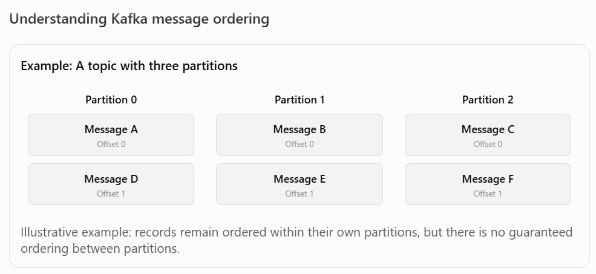

# 4.4 Kafka console consumer CLI

This lecture demonstrates how to read Kafka records with `kafka-console-consumer.sh`, including consuming only new records, reading existing records from the beginning, and displaying message metadata. The central lesson is that **Kafka preserves record order within each partition, not across an entire multi-partition topic**.

## Learning objectives

- Consume new messages as they arrive.
- Read existing messages using `--from-beginning`.
- Compare one-partition and three-partition topics.
- Display timestamps, keys, values, and partition numbers.
- Observe the effect of a round-robin producer in a learning exercise.

## 1. Create a topic with three partitions

The instructor uses a second topic with three partitions to demonstrate partition-level ordering. On a local single-broker setup, use replication factor 1:

```bash
kafka-topics.sh \
  --bootstrap-server localhost:9092 \
  --create \
  --topic second_topic \
  --partitions 3 \
  --replication-factor 1
```

The lecture also compares this with `first_topic`, which has only one partition.

## 2. Consume only new messages

```bash
kafka-console-consumer.sh \
  --bootstrap-server localhost:9092 \
  --topic second_topic
```

The console waits for new records. Existing records are not replayed by this default example. Open a second terminal to produce messages while the consumer remains running. Stop the consumer with **Ctrl+C**.

## 3. Produce sample messages

For the classroom demonstration, the instructor explicitly configures a round-robin partitioner so successive records can be distributed across the topic's partitions:

```bash
kafka-console-producer.sh \
  --bootstrap-server localhost:9092 \
  --topic second_topic \
  --producer-property partitioner.class=org.apache.kafka.clients.producer.RoundRobinPartitioner
```

Example inputs (press Enter after each):

```text
hello world
my name is Stephane
it's working
one
two
three
```

**Lecture note:** The instructor uses round robin for visualization, not as a recommended production partitioning strategy. The default producer can keep records on one partition for a while because of batching and partitioning optimizations.

## 4. Consume from the beginning

```bash
kafka-console-consumer.sh \
  --bootstrap-server localhost:9092 \
  --topic second_topic \
  --from-beginning
```

This example reads previously produced records as well as continuing to wait for new ones. The output may differ from the original send order because the topic has three partitions.

For the single-partition `first_topic`, records are read in their partition order:

```bash
kafka-console-consumer.sh \
  --bootstrap-server localhost:9092 \
  --topic first_topic \
  --from-beginning
```

## 5. Display keys, values, timestamps, and partitions

```bash
kafka-console-consumer.sh \
  --bootstrap-server localhost:9092 \
  --topic second_topic \
  --from-beginning \
  --formatter kafka.tools.DefaultMessageFormatter \
  --property print.timestamp=true \
  --property print.key=true \
  --property print.value=true \
  --property print.partition=true
```

These formatting properties make it easier to see where each record is stored:

| Property | Meaning |
|---|---|
| `print.timestamp=true` | Show record timestamp |
| `print.key=true` | Show record key |
| `print.value=true` | Show record value |
| `print.partition=true` | Show partition number |
| `--from-beginning` | Read available earlier records for this consumer session |

The instructor also demonstrates filtering a topic by partition in the Conduktor UI and inspecting metadata such as **partition 0, offset 1**.

## 6. Understanding message ordering

- **One partition:** Records have a single partition order, but partition-level parallelism is limited.
- **Multiple partitions:** Records are ordered **within** each partition, but there is no guaranteed global order across partitions.
- **Round-robin demonstration:** Records are intentionally sent to different partitions so this distinction is visible.
- **Offsets:** Each partition has its own sequence of offsets; an offset identifies a record's position within that partition.

## 7. Quick command reference

| Goal | Option / command |
|---|---|
| Start consumer | `kafka-console-consumer.sh` |
| Connect to broker | `--bootstrap-server localhost:9092` |
| Select topic | `--topic second_topic` |
| Read previous records | `--from-beginning` |
| Show message key | `--property print.key=true` |
| Show message value | `--property print.value=true` |
| Show partition | `--property print.partition=true` |
| Show timestamp | `--property print.timestamp=true` |
| Stop consumer | `Ctrl+C` |

## Hands-on checklist

- [ ] Create `second_topic` with three partitions.
- [ ] Start a console consumer and observe it waiting.
- [ ] Open a second terminal and produce several messages.
- [ ] Restart the consumer without `--from-beginning` and observe that it waits for new messages.
- [ ] Restart with `--from-beginning` and observe previous records.
- [ ] Enable partition, key, value, and timestamp printing.
- [ ] Compare record ordering in one-partition and three-partition topics.
- [ ] Inspect partition and offset information in Conduktor, if available.

## Key takeaway

**Kafka guarantees ordering within a partition, not across all partitions in a topic.** Use `--from-beginning` to inspect earlier records and formatter properties to see message metadata. The instructor uses a round-robin producer solely to make multi-partition behavior easier to observe.

*Based on the supplied “Kafka console consumer CLI” lecture transcript. Commands use the Linux/macOS/WSL2 `.sh` form and a local broker at `localhost:9092`; adapt them to your environment.*

## Key concepts
1. Kafka Console Consumer: Reads messages from Kafka topics using the terminal.
2. Consume new messages: By default, the demonstrated consumer starts reading newly arriving messages.
3. Consume from the beginning: Use --from-beginning to read previously produced messages.
4. Kafka partitions: Messages are distributed across partitions for scalability.
5. Message ordering: Kafka guarantees ordering within each partition, not across the entire topic.
6. Round-robin partitioner: Distributes messages across partitions for demonstration purposes.
7. Message metadata: Display timestamps, keys, values, and partition numbers.

## Important Kafka CLI commands
| Operation	             | Command or option         | 
|------------------------|---------------------------| 
| Start consumer	     | kafka-console-consumer.sh | 
| Specify broker	     | --bootstrap-server        | 
| Specify topic	         | --topic                   | 
| Read earlier messages	 | --from-beginning          | 
| Display keys	         | print.key=true            | 
| Display values	     | print.value=true          | 
| Display partitions	 | print.partition=true      | 
| Display timestamps	 | print.timestamp=true      | 
| Stop consumer	         | Ctrl+C                    | 

**Example 1: Consume new messages**
```bash
kafka-console-consumer.sh \
  --bootstrap-server localhost:9092 \
  --topic second_topic
```

**Example 2: Consume from the beginning**
```bash
kafka-console-consumer.sh \
  --bootstrap-server localhost:9092 \
  --topic second_topic \
  --from-beginning
```

**Example 3: Display message metadata**
```bash
kafka-console-consumer.sh \
  --bootstrap-server localhost:9092 \
  --topic second_topic \
  --from-beginning \
  --property print.timestamp=true \
  --property print.key=true \
  --property print.value=true \
  --property print.partition=true
```



**Key takeaway:** Kafka consumers preserve message ordering within individual partitions. Using --from-beginning and message-formatting properties helps you understand how records are stored and consumed.

## [Context](./../../context.md)