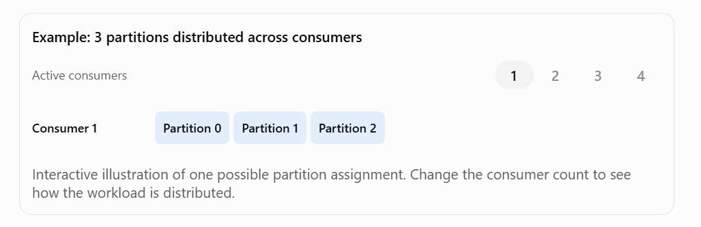
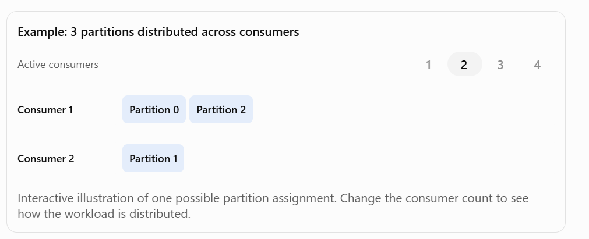
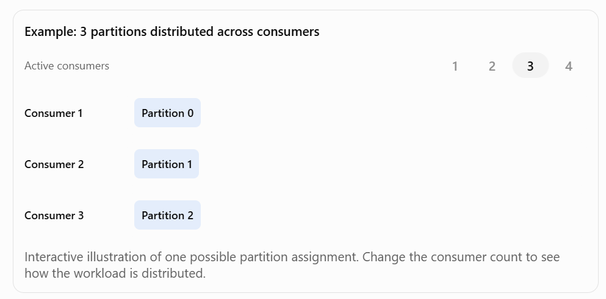
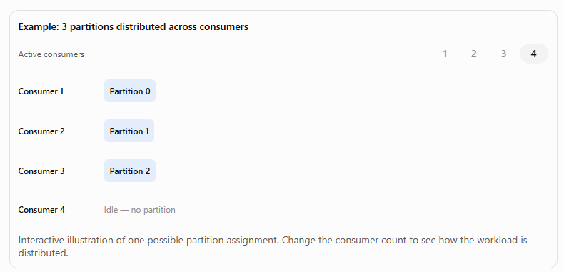

# 4.5 Kafka consumers in groups

This lecture demonstrates how Kafka consumers cooperate in a **consumer group**. Consumers with the same group ID divide topic partitions among themselves, allowing parallel processing. The instructor uses a topic with **three partitions**, a console producer, and multiple console consumers to demonstrate assignment, rebalancing, lag, and committed offsets.

## Learning objectives

- Create a Kafka topic with three partitions.
- Start console consumers with the `--group` option.
- Observe how partitions are assigned when consumers join or leave.
- Understand what happens when there are more consumers than partitions.
- See how a restarted consumer group catches up on unread messages.
- Compare existing groups with new groups using `--from-beginning`.

## 1. Create a topic with three partitions

```bash
kafka-topics.sh \
  --bootstrap-server localhost:9092 \
  --create \
  --topic third_topic \
  --partitions 3 \
  --replication-factor 1
```

The one-broker local example uses replication factor 1. Adjust broker connection and security configuration for other environments.

## 2. Start a consumer in a group

```bash
kafka-console-consumer.sh \
  --bootstrap-server localhost:9092 \
  --topic third_topic \
  --group my-first-application
```

`--group` identifies the consumer group. When it is the only active member, this consumer can be assigned all three partitions. It waits for new records if there are none to read.

## 3. Produce test messages

Open a second terminal:

```bash
kafka-console-producer.sh \
  --bootstrap-server localhost:9092 \
  --topic third_topic \
  --producer-property partitioner.class=org.apache.kafka.clients.producer.RoundRobinPartitioner
```

Type a message and press Enter to send it. The instructor uses a round-robin partitioner **for teaching**, so messages are visibly spread among partitions; the lecture cautions against using it as a production recommendation.

## 4. Add consumers to the same group

Run the consumer command from section 2 in additional terminals, keeping the **same topic and group ID**.

| Active consumers | Topic partitions | Typical assignment in this example |
|---|---:|---|
| 1 | 3 | One consumer receives all 3 partitions |
| 2 | 3 | One receives 2 partitions, the other 1 |
| 3 | 3 | Each receives 1 partition |
| 4 | 3 | Three receive partitions; one is idle |

A partition is assigned to at most one active consumer **within the same group** at a time. The exact assignment can change when the group rebalances.

## 5. Consumer rebalancing

When a consumer joins or leaves the group, Kafka redistributes partition assignments among the remaining members. In the lecture:

1. Four consumers share a three-partition topic, leaving one without an assignment.
2. Stopping a consumer triggers reassignment.
3. With two consumers, one may read from two partitions and the other from one.
4. With one consumer left, it reads from all three partitions.

This illustrates how consumer groups scale processing up to the available number of partitions.

## 6. Catch up after consumers stop

The instructor stops all consumers, produces more records (for example, `J` and `K`), then restarts a consumer with the **same group ID**. The group reads records it had not yet processed from its stored position, demonstrating catch-up and consumer lag.

Messages from different partitions need not appear in the original overall production order; Kafka maintains order **within each partition**.

## 7. New consumer group and `--from-beginning`

Start a different group:

```bash
kafka-console-consumer.sh \
  --bootstrap-server localhost:9092 \
  --topic third_topic \
  --group my-second-application \
  --from-beginning
```

A **new group with no committed offsets** can read retained records from the beginning. After that group has committed offsets, restarting it with `--from-beginning` does **not** automatically reset its position: it resumes from committed offsets. This is the distinction demonstrated in the lecture.

## Key terms

| Term | Meaning |
|---|---|
| Consumer group | Consumers using the same group ID to coordinate work |
| Group ID | Identifier provided by `--group` |
| Partition assignment | Distribution of topic partitions across active group members |
| Rebalance | Reassignment when group membership changes |
| Consumer lag | Records not yet consumed relative to the latest available offsets |
| Committed offset | Stored group position used when consumption resumes |
| `--from-beginning` | Start at earliest retained records when there is no committed position for that group |

## Practical exercise

1. Create `third_topic` with three partitions.
2. Start one consumer in `my-first-application`.
3. Produce several messages and observe the output.
4. Start second and third consumers in the same group; send more messages.
5. Start a fourth consumer and observe that it has no partition assigned.
6. Stop consumers one by one and observe rebalancing.
7. Stop all consumers, produce `J` and `K`, and restart the original group.
8. Start `my-second-application` with `--from-beginning` and observe historical messages.
9. Restart that second group to observe committed-offset behavior.

## Key takeaway

**Within one consumer group, Kafka distributes partitions among consumers, not individual copies of every message to every consumer.** Adding consumers increases parallelism only up to the number of partitions. Rebalancing redistributes work, and committed offsets allow a group to resume where it left off.

*Source: user-provided transcript, “Kafka consumers in groups,” Stephane from Conduktor. Commands are illustrative localhost examples aligned with the lecture.*

## Key concepts
1. Consumer groups: Multiple Kafka consumers work together using the same group ID.
2. Partition assignment: Kafka distributes partitions among consumers in the same group.
3. Consumer scaling: Adding consumers increases parallel processing up to the number of partitions.
4. Idle consumers: If there are more consumers than partitions, some consumers remain idle.
5. Rebalancing: Kafka redistributes partitions when consumers join or leave.
6. Consumer lag: Consumers can catch up on messages produced while they were stopped.
7. Committed offsets: Kafka tracks where consumer groups should resume reading.
8. --from-beginning: New consumer groups can read retained messages from the beginning.

**Consumer group partition assignment**









## Important Kafka CLI commands
**Step 1: Create a topic with three partitions**
```bash
kafka-topics.sh \
  --bootstrap-server localhost:9092 \
  --create \
  --topic third_topic \
  --partitions 3 \
  --replication-factor 1
```

**Step 2: Start a consumer group**
```bash
kafka-console-consumer.sh \
  --bootstrap-server localhost:9092 \
  --topic third_topic \
  --group my-first-application
```

**Step 3: Start another consumer in the same group**

Run the same command in another terminal. Kafka will rebalance the partitions.

**Step 4: Start a new group from the beginning**
```bash
kafka-console-consumer.sh \
  --bootstrap-server localhost:9092 \
  --topic third_topic \
  --group my-second-application \
  --from-beginning
```

**Consumer assignment behavior**
| Consumers | Partitions | 	Behavior                            | 
|-----------|------------|--------------------------------------|  
| 1	        | 3     	 | One consumer reads all partitions    | 
| 2	        | 3	         | Partitions divided 2 and 1           | 
| 3	        | 3	         | Each consumer receives one partition | 
| 4	        | 3	         | One consumer remains idle            | 

**Key takeaway:** Kafka consumer groups enable parallel message processing by assigning different partitions to consumers. Each partition is assigned to only one active consumer within the same group at a time.

## [Context](./../../context.md)