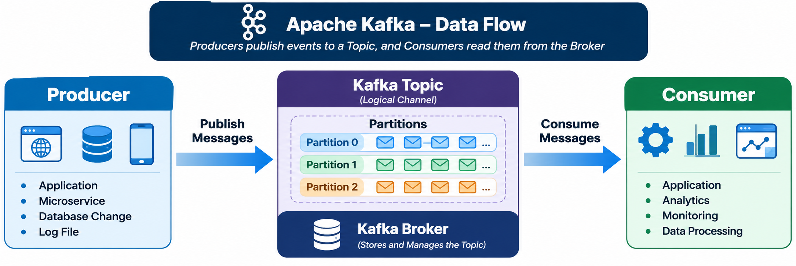

# Kafka-Deep-Dives

# Tutorials
* [Complete_Guide_to_Apache_Kafka_for_Beginners](/Complete_Guide_to_Apache_Kafka_for_Beginners/context.md)

# Table of Contents

**Debian Linux**
* [How to install Apache Kafka on Debian](./Table_of_Contents/Install_Apache_Kafka_on_Debian/Install_Apache_Kafka_on_Debian.md)

# Introduction to Apache Kafka

Apache Kafka is an open-source distributed event streaming platform designed to handle high-volume, real-time data streams. Originally developed by LinkedIn and later donated to the Apache Software Foundation, Kafka is widely used for building real-time data pipelines, event-driven applications, and streaming analytics systems.

At its core, Kafka enables applications to publish, store, process, and consume streams of records efficiently and reliably. It is capable of handling millions of messages per second while ensuring scalability, fault tolerance, and high availability.

## Why Kafka?

Modern applications generate large amounts of data from sources such as web applications, mobile devices, sensors, databases, and microservices. Kafka acts as a central platform that allows these systems to exchange data in real time without direct dependencies on each other.

Key benefits of Kafka include:

* High throughput and low latency
* Horizontal scalability across multiple servers
* Fault tolerance through data replication
* Durable message storage
* Real-time data processing capabilities
* Integration with various data sources and applications

## Core Components of Kafka
**Producer**

A producer is an application that sends messages (events) to Kafka topics.

**Topic**

A topic is a logical category or channel where messages are stored. Producers write data to topics, and consumers read data from topics.

**Broker**

A broker is a Kafka server responsible for storing and serving messages. A Kafka cluster typically consists of multiple brokers.

**Consumer**

A consumer reads and processes messages from Kafka topics.

**Partition**

Topics are divided into partitions, allowing Kafka to distribute data across multiple brokers and process it in parallel.

**Consumer Group**

Multiple consumers can work together as a consumer group to increase processing capacity and provide fault tolerance.

## How Kafka Works
1. Producers send messages to a Kafka topic.
2. Kafka brokers store the messages in topic partitions.
3. Consumers subscribe to topics and read messages.
4. Kafka retains messages for a configurable period, allowing consumers to replay historical data if needed.

				
* **Producer:** Applications, microservices, database changes, and log files.
* **Kafka Topic:** A logical channel that organizes messages.
* **Partitions:** Messages are distributed across multiple partitions.
* **Kafka Broker:** Stores and manages topic partitions.
* **Consumer:** Reads messages for applications, analytics, monitoring, and data processing.
* **Arrows:** Show the direction of message flow.

## Common Use Cases
* Log aggregation and monitoring
* Real-time analytics
* Event sourcing
* Data integration between systems
* Stream processing
* Microservices communication
* Internet of Things (IoT) data collection

## Conclusion

Apache Kafka is a powerful platform for building scalable, reliable, and real-time data streaming applications. Its distributed architecture, fault tolerance, and high performance make it a popular choice for organizations that need to process and move large volumes of data efficiently across modern software systems.
